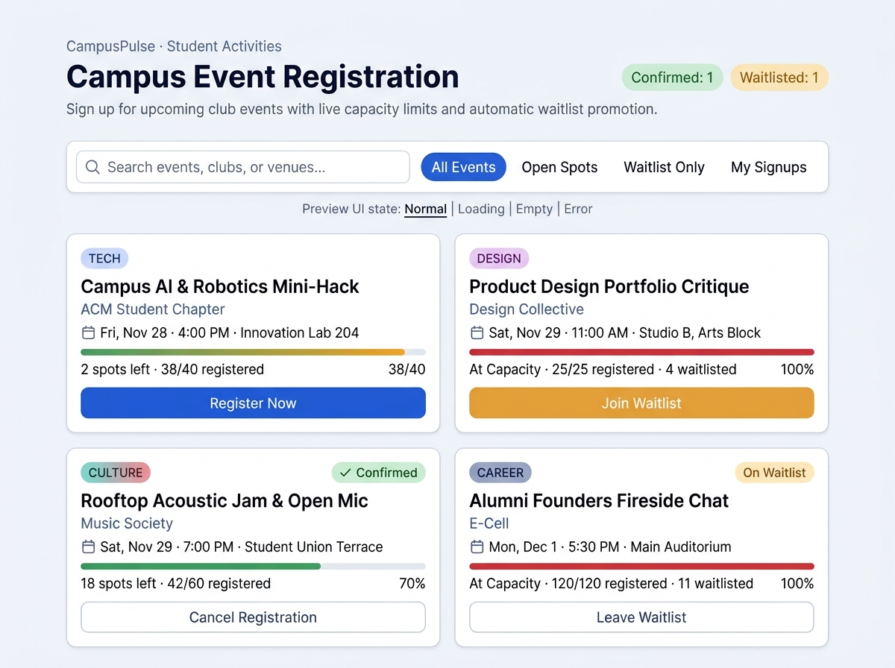

# Day 5 – React State & Component Design: Campus Event Registration

A React + Vite prototype for **Campus Event Registration** featuring **capacity limits**, **waitlist signup**, **automatic waitlist promotion on cancellation**, and explicit **loading**, **empty**, and **error** UI states.



## Setup & Running

```bash
cd day5-campus-event-registration
npm install
npm run dev
```

### Run Tests

```bash
npm test
```

Latest test run output:
```text
 ✓ src/App.test.jsx (4 tests) 239ms
 Test Files  1 passed (1)
      Tests  4 passed (4)
```

## Reusable Components (4)

1. `src/components/EventCard.jsx` — Displays event metadata, user registration badge (`Confirmed` / `On Waitlist`), `CapacityMeter`, and context-aware action button (`Register Now`, `Join Waitlist`, `Cancel Registration`, `Leave Waitlist`).
2. `src/components/CapacityMeter.jsx` — Pure presentational progress bar and spot/waitlist counter (`open`, `filling-fast`, and `full` states).
3. `src/components/FilterBar.jsx` — Controlled search bar, availability filter tabs (`All Events`, `Open Spots`, `Waitlist Only`, `My Signups`), and UI state preview toggles (`Normal`, `Loading`, `Empty`, `Error`).
4. `src/components/StateFeedback.jsx` — Reusable state presenter for skeleton `loading`, `empty` (with clear/reload action), and `error` (with `Retry` action).

## State Ownership

- **Page-level owner (`src/App.jsx`)**: Owns all canonical state:
  - `events` (source of truth for capacity, `registeredCount`, `waitlistCount`, and `userStatus`)
  - `status` (`'loading' | 'ready' | 'error'`) & `errorMessage`
  - `searchQuery`, `activeFilter`, `demoMode`, `busyEventId`, and `bannerMessage`
- **Controlled children**: `FilterBar`, `EventCard`, `CapacityMeter`, and `StateFeedback` hold **no local business state**; they receive derived props and invoke parent callbacks (`onRegister`, `onCancel`, `onSearchChange`, `onFilterChange`).
- **Derived state**: `filteredEvents` and `summary` (`Confirmed` / `Waitlisted` counts) are computed via `useMemo` rather than duplicated in separate `useState` hooks, preventing stale counts.

## Trade-Off Note

- **Trade-off: Lifting all event & filter state to `App.jsx` with client-side transitions vs. server-backed optimistic mutations + React Query / Context.**
  - Keeping a single canonical `events` array in `App.jsx` with pure transition functions (`applyRegistration`, `applyCancellation`) makes capacity enforcement and waitlist promotion deterministic, easy to unit-test, and free of prop/state sync bugs.
  - The trade-off is that concurrent registrations from other students aren't reflected in real time without polling or WebSockets, and if the app grows to multiple routes (e.g. an Event Detail page and a Student Profile page), we would move `events` into a server-state cache (like TanStack Query) backed by atomic backend transactions.
