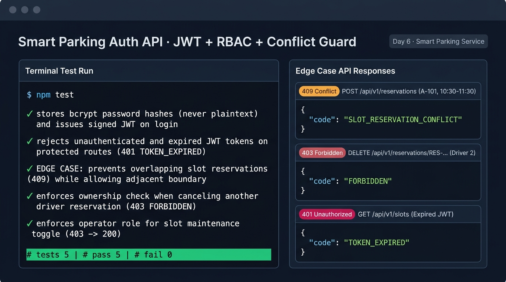

# Day 6 – Authentication & Authorization: Smart Parking Service

A compact Express + JWT implementation for a **Smart Parking Service** handling **slot availability** and **reservation conflicts** with bcrypt password hashing, short-lived JWT tokens, protected routes, role/ownership checks, and a threat note.



## Setup & Running

```bash
cd day6-smart-parking-auth
cp .env.example .env   # set JWT_SECRET locally; never commit .env
npm install
npm test               # runs 5 automated integration tests
npm run demo           # demonstrates login, expired JWT, 409 conflict, and 403 ownership
```

## Implementation Note

- **Password Hashing (`src/routes/authRoutes.js`, `src/store/parkingStore.js`)**: Passwords are hashed with `bcryptjs` (`10` salt rounds) on registration/seeding and verified with `bcrypt.compare` at login. Plaintext passwords are never stored.
- **JWT Login & Expiry (`src/config.js`, `src/middleware/auth.js`)**: `POST /api/v1/auth/login` signs an `HS256` JWT containing `{ sub, email, role }` with `expiresIn: '15m'`. `JWT_SECRET` is loaded from `process.env.JWT_SECRET` (throwing in `production` if missing; using an ephemeral `crypto.randomBytes(32)` key in local dev/test so no secret is ever committed). Expired tokens return `401 TOKEN_EXPIRED`.
- **Protected Routes, Roles & Ownership (`src/routes/parkingRoutes.js`)**:
  - `GET /api/v1/slots?startTime=&endTime=` — Authenticated slot listing with live window availability.
  - `POST /api/v1/reservations` — Authenticated booking; checks maintenance status and overlapping time-window conflicts.
  - `DELETE /api/v1/reservations/:id` — **Ownership check**: allows cancellation only if `reservation.userId === req.user.sub` or `req.user.role === 'operator'` (`403 FORBIDDEN` otherwise).
  - `PATCH /api/v1/slots/:id/maintenance` — **Role check**: restricted via `requireRole('operator')` (`403 FORBIDDEN` for `driver`).

## Edge Case Demonstrated: Overlapping Reservation Conflict (`409`)

- **Scenario**: `driver1` books slot `A-101` from `10:00` to `11:00`. `driver2` then attempts to reserve `A-101` from `10:30` to `11:30`.
- **Result**: `hasTimeOverlap(startA, endA, startB, endB)` (`startA < endB && endA > startB`) detects the partial overlap and rejects `driver2` with `409 SLOT_RESERVATION_CONFLICT` (while an adjacent `11:00–12:00` booking succeeds with `201`).

## Short Threat Note

1. **Secret Management**: Never commit `.env` or hardcode signing keys; require `JWT_SECRET` from environment/secret manager in production and rotate keys if compromised.
2. **Token Theft & Blast Radius**: Keeping access tokens short-lived (`15m`) limits exposure if a token is leaked, while pinning `{ algorithms: ['HS256'] }` in `jwt.verify()` prevents `alg=none` or algorithm-confusion attacks.
3. **IDOR & Privilege Escalation**: Every reservation mutation checks `req.user.sub` ownership (or `operator` role), and `POST /api/v1/auth/register` always assigns the least-privilege `driver` role regardless of request body fields.
4. **Double-Booking Race Conditions**: In-memory checks are sufficient for a single-process prototype, but production deployments should back reservations with a database exclusion constraint or atomic transaction on `(slotId, startTime, endTime)`.
